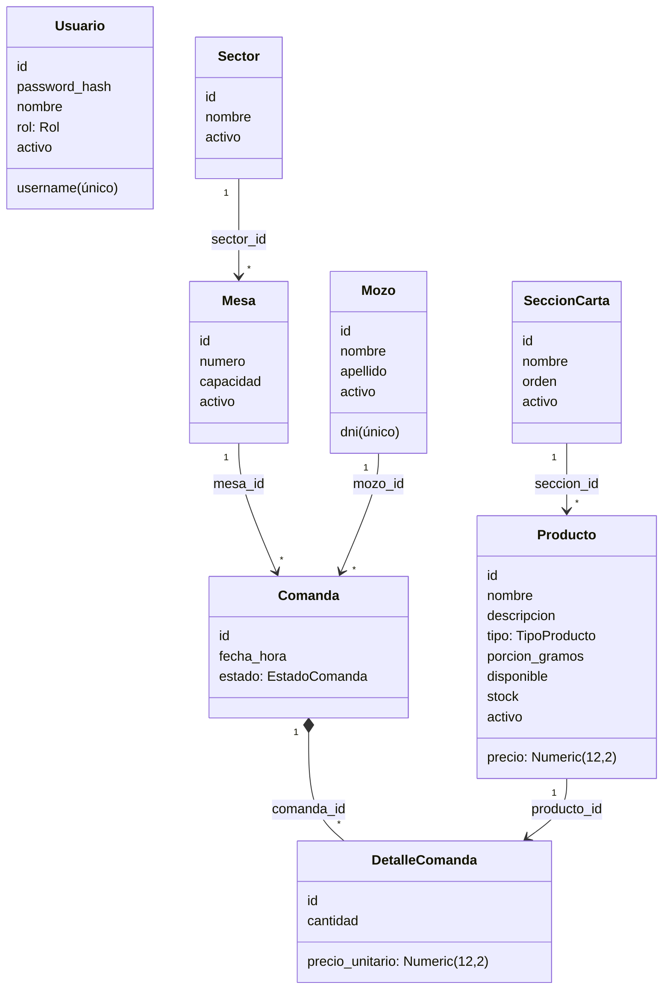

# Modelo de datos mínimo

La base trae **solo las entidades que varias HU necesitan a la vez**, y de cada una solo su
identificación, sus relaciones, la baja lógica y el estado. Así nadie queda bloqueado esperando
que otro cree "su" tabla (por ejemplo, la comanda necesita Mesa, Mozo y Producto).

**Todo lo demás lo agrega la HU dueña**: atributos, validaciones y entidades nuevas.

Los modelos están en `backend/app/models/` (SQLAlchemy 2, estilo `Mapped[...]`).

## Diagrama

## Tablas

| Tabla (archivo) | Columnas en la base | HU dueña | Lo que agrega la HU (según las HU finales) |
|---|---|---|---|
| `usuario` (`usuario.py`) | id, username (único), password_hash, nombre, rol, activo | base | HU-02 decide si se vincula con Mozo. |
| `sector` (`salon.py`) | id, nombre, activo | HU-01a | descripción; nombre único entre activos. |
| `mesa` (`salon.py`) | id, numero, capacidad, sector_id, activo | HU-01b | número único entre activas; capacidad > 0; bloqueos por reserva o comanda. |
| `mozo` (`personal.py`) | id, dni (único), nombre, apellido, activo | HU-02 | teléfono, turno, sector asignado. |
| `seccion_carta` (`carta.py`) | id, nombre, orden, activo | HU-03a | validaciones de nombre (3 a 50, único entre activas) y orden. |
| `producto` (`carta.py`) | id, nombre (60), descripcion, precio, tipo, seccion_id, porcion_gramos, disponible, stock, activo | HU-04a–d | Agregadas en HU-04a: descripción (≤ 200), porción en gramos (plato/postre), disponible y stock (lógica en HU-04d). Pendiente: volumen y alcohólica (bebida). |
| `comanda` (`comandas.py`) | id, fecha_hora, mesa_id, mozo_id, estado (ABIERTA por defecto) | HU-05a | comensales, turno, reserva asociada. |
| `detalle_comanda` (`comandas.py`) | id, comanda_id, producto_id, cantidad, precio_unitario | HU-05b, HU-06 | estado de entrega (HU-06). |

Notas:

- **Baja lógica:** la columna `activo` (`True` por defecto). Eliminar = poner `activo = False`.
- **Unicidad "entre activos"** (sector, mesa, sección, producto): no está como restricción de la
  base, porque un registro dado de baja puede repetir el nombre. La valida el `service` de la HU.
- **`precio_unitario`** guarda el precio del producto al momento de cargarlo en la comanda, para
  que un cambio de precio no afecte comandas abiertas (HU-04a CA5).
- **Producto** es una sola tabla con la columna `tipo` (PLATO, POSTRE, BEBIDA). HU-04 decide si
  agrega columnas propias de cada tipo en la misma tabla o usa herencia de SQLAlchemy.
- Los montos son `Numeric(12, 2)` → `Decimal` en Python (nunca `float`).

## Enumerados (`backend/app/core/enums.py`)

| Enumerado | Valores | Notas |
|---|---|---|
| `Rol` | `ADMINISTRADOR`, `MOZO` | Cada HU agrega su rol: `CAJERO` (HU-08), `RECEPCIONISTA` (HU-10/11), `ENCARGADO_GENERAL` (HU-09), `COCINERO` (HU-09b). Copiarlo también en `frontend/src/lib/roles.ts`. |
| `TipoProducto` | `PLATO`, `POSTRE`, `BEBIDA` | |
| `EstadoComanda` | `ABIERTA`, `CERRADA`, `FACTURADA`, `ANULADA` | Definidos por HU-05 (decisión del grupo). |

Se guardan como texto en la base (`native_enum=False`), así que agregar un valor nuevo no requiere
cambiar la tabla.

## Entidades que todavía no existen

Las crea su HU, en un archivo nuevo de `app/models/` (y se importan en `app/models/__init__.py`):

| Entidad | HU |
|---|---|
| Cliente | HU-10 |
| Reserva (y su relación N:M con Mesa) | HU-11a |
| Menú (ejecutivo / del día) | HU-09b |
| Promoción | HU-09a |
| PreTicket | HU-05c |
| MedioPago | HU-07a |
| Factura, Pago / comprobante | HU-08a, HU-08b |
| Seña | sin definir (pendiente del grupo) |

## Cómo cambiar el modelo

1. Editar o crear el archivo en `app/models/`. Si es un archivo nuevo, importarlo en
   `app/models/__init__.py` (si no, `create_all` no crea la tabla).
2. Recrear la base: `python -m app.seed` (no hay migraciones).
3. Los cambios a tablas que usan otros (sobre todo `mesa`, `mozo`, `producto`, `comanda`) se
   hacen **en un commit aparte y avisando al grupo**, porque al integrar todos tienen que recrear
   su base.
